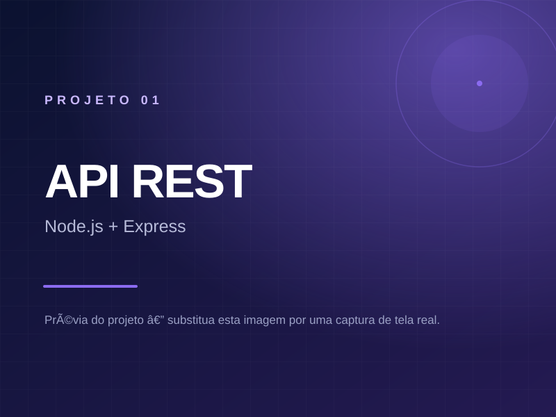

# Portfólio Acadêmico — Marjorie da Silva Santos

Currículo acadêmico digital desenvolvido para reunir a trajetória, os projetos, a experiência
prática e as conquistas obtidas durante o curso de **Informática** no **Instituto Federal de Mato
Grosso do Sul (IFMS), campus Nova Andradina**.

- **Autora:** Marjorie da Silva Santos
- **Curso:** Informática
- **Instituição:** IFMS — campus Nova Andradina (MS)
- **E-mail:** marjorie.santos@estudante.ifms.edu.br
- **GitHub:** <https://github.com/marjoriesantos-netizen>
- **Link do site publicado:** _preencher após a publicação no GitHub Pages_

---

## 1. Objetivo

O site funciona como um **currículo acadêmico digital**. Ele não é uma página de propaganda
profissional nem afirma intenção de seguir carreira em programação: o foco é documentar, de forma
organizada e profissional, o que foi aprendido e realizado durante a formação no IFMS.

O conteúdo está dividido em oito seções navegáveis: Início, Formação, Experiência, Projetos,
Conquistas, Atividades, Conhecimentos e Contato.

---

## 2. Informações verificadas sobre os projetos

Antes de escrever as descrições, os cinco repositórios e os sites publicados foram consultados no
GitHub. As informações abaixo são as que puderam ser **confirmadas** nos arquivos dos repositórios
(README, `package.json`, `server.js`, HTML e CSS) — nada foi inventado.

| # | Projeto | Site publicado | Repositório | O que foi confirmado |
|---|---------|----------------|-------------|----------------------|
| 1 | Exercícios de aula 03 | <https://marjoriesantos-netizen.github.io/exercicios-aula-03/> | <https://github.com/marjoriesantos-netizen/exercicios-aula-03> | Servidor em Node.js com Express, rotas de API REST (`/products`, `/products/:id`, usuários), leitura e gravação de arquivos JSON. A página publicada apresenta a documentação do projeto. |
| 2 | Atividade colaborativa | <https://marjoriesantos-netizen.github.io/atividade-colaborativa/> | <https://github.com/marjoriesantos-netizen/atividade-colaborativa> | Página em HTML5 sobre prática de funcionalidades, branches, commits, correções e pull requests. |
| 3 | Atividade 3 | <https://marjoriesantos-netizen.github.io/atividade-3/> | <https://github.com/marjoriesantos-netizen/atividade-3> | README da disciplina de Desenvolvimento Web: React, JavaScript, API REST, `fetch` e `useEffect`. O repositório documenta a atividade. |
| 4 | Atividade 1: Git e GitHub | <https://marjoriesantos-netizen.github.io/atividade-1-git-github/> | <https://github.com/marjoriesantos-netizen/atividade-1-git-github> | `index.html`, `style.css` e `script.js` (função de mensagem), com três imagens, praticando comandos do Git. |
| 5 | Projeto Fabio | <https://marjoriesantos-netizen.github.io/projetofabio/> | <https://github.com/marjoriesantos-netizen/projetofabio> | “Aura NFT”, desafio Frontend Mentor com HTML5, CSS3, JavaScript puro, Animate.css, Google Fonts, cabeçalho responsivo, cards gerados por dados e animações de hover. |

> **Observação:** o repositório `atividade-3` contém, na pasta `atividade-api-react`, apenas um
> arquivo de texto com a descrição da atividade. Por isso, a descrição no site diz que o repositório
> **documenta** a proposta, sem afirmar que a aplicação React está publicada. Se o código for
> adicionado depois, a descrição pode ser ampliada.

---

## 3. Tecnologias utilizadas

- **HTML5 semântico** — seções, artigos, listas de descrição, `<figure>` e atributos ARIA.
- **CSS3** — variáveis de design, Grid, Flexbox, `clamp()`, gradientes, animações e media queries.
- **JavaScript puro (ES6+)** — nenhuma biblioteca ou framework é necessário.
- **Git e GitHub** — sugeridos para versionamento e publicação.
- **GitHub Pages** — hospedagem estática, sem servidor próprio.
- **Google Fonts** — fontes Sora e Inter (com alternativas locais no `font-family`).

---

## 4. Estrutura de arquivos

```text
Projeto Padrão/                ← esta pasta é a raiz do site
├── index.html                 ← página única com todas as seções
├── css/
│   └── style.css              ← estilos, responsividade e acessibilidade
├── js/
│   └── script.js              ← menu, rolagem, galeria, ano e botão de topo
├── img/
│   ├── favicon.png            ← ícone do site
│   ├── og-image.png           ← imagem de compartilhamento em redes sociais
│   ├── projetos/              ← capturas de tela dos projetos
│   │   ├── projeto-1.svg      ← espaços reservados (substituir pelas capturas)
│   │   ├── projeto-2.svg
│   │   ├── projeto-3.svg
│   │   ├── projeto-4.svg
│   │   └── projeto-5.svg
│   └── fecinova/              ← fotografias da FECINOVA
│       ├── fec-01-banner.jpg
│       ├── fec-02-evento.jpg
│       ├── fec-03-certificado.jpg
│       ├── fec-04-registro.jpg
│       ├── fec-05-registro.jpg
│       └── fec-06-registro.jpg
├── README.md
└── .nojekyll                  ← impede o processamento desnecessário pelo Jekyll
```

**Por que os arquivos estão na raiz?** O PDF sugeria a pasta `portfolio-marjorie/`. Como a
publicação no GitHub Pages fica mais simples quando o `index.html` está na raiz do repositório,
a estrutura foi adaptada (o que o próprio documento permitia, com justificativa técnica). O nome
sugerido para o repositório continua sendo **`portfolio-marjorie`**.

---

## 5. Funcionalidades implementadas

- Menu fixo com **destaque da seção atual** durante a rolagem.
- Menu responsivo para celulares e tablets, com fechamento por teclado (`Esc`), clique fora e
  clique em um link.
- **Rolagem suave** entre as seções, com foco enviado ao destino (melhora a navegação por teclado
  e leitores de tela).
- **Animações discretas** de entrada ao rolar, desativadas para quem prefere movimento reduzido.
- **Galeria da FECINOVA** com visualização ampliada: abre pelo teclado, navega com as setas
  `←`/`→`, fecha com `Esc` e mantém o foco preso na janela enquanto está aberta.
- Botão **“Voltar ao topo”**, exibido apenas quando a página é rolada.
- **Ano do rodapé** atualizado automaticamente com JavaScript.
- Link de e-mail via `mailto:` e links reais para o GitHub.
- Layout responsivo em computadores, tablets e celulares.
- Acessibilidade: link “pular para o conteúdo”, contraste adequado, foco visível, textos
  alternativos, `aria-expanded`, `aria-current`, `aria-modal` e suporte a `prefers-reduced-motion`.
- Funciona em hospedagem estática (GitHub Pages) sem servidor próprio.
- Sem botões decorativos: todas as interações fazem algo.

---

## 6. Como visualizar o site localmente

### Opção A — abrir diretamente

1. Abra a pasta do projeto no Explorador de Arquivos.
2. Dê duplo clique em `index.html`.

O site abre no navegador. As fontes externas podem não carregar sem internet, mas o layout usa
fontes alternativas do sistema.

### Opção B — servidor local (recomendado para testar caminhos)

Com o **VS Code**:

1. Instale a extensão **Live Server**.
2. Clique com o botão direito em `index.html` → **Open with Live Server**.

Com **Python** instalado, no terminal dentro da pasta:

```bash
python -m http.server 8000
```

Depois acesse <http://localhost:8000>.

> Testar por servidor local ajuda a detectar problemas de caminho de imagem e de acentuação nos
> nomes de arquivos.

---

## 7. Como personalizar

### 7.1 Fotografia pessoal (opcional)

1. Salve sua foto como `img/perfil.jpg` (de preferência quadrada, com pelo menos 800 × 800 px).
2. Abra o `index.html` e procure o comentário `Para usar uma fotografia pessoal`.
3. Descomente a linha `` e apague a linha
   `<span class="portrait-card__monogram">MS</span>`.

Enquanto não houver foto, o cartão mostra o monograma “MS” — não fica com aparência de imagem
quebrada.

### 7.2 Capturas de tela dos projetos

Os cartões usam, por enquanto, imagens `.svg` com a indicação “Prévia do projeto”. Para trocar:

1. Faça a captura de tela do site publicado (recomendado: **1200 × 900 px**, formato 4:3).
2. Salve em `img/projetos/` com nomes simples e sem espaços, por exemplo:
   `projeto-1.jpg`, `projeto-2.jpg`, `projeto-3.jpg`, `projeto-4.jpg` e `projeto-5.jpg`.
3. No `index.html`, em cada `<article class="project-card">`, altere o `src` da imagem:

```html
<!-- antes -->


<!-- depois -->

```

4. Preencha o `alt` com uma descrição curta da imagem (importante para acessibilidade).
5. Se quiser manter o mesmo nome, salve a captura como `projeto-1.svg`? **Não** — SVG e JPG são
   formatos diferentes. Sempre atualize o `src`.

Dica: a primeira captura pode ser feita com a janela do navegador maximizada e o zoom em 100%,
para manter as proporções parecidas entre os cartões.

### 7.3 Fotos da FECINOVA e legendas

As seis imagens em `img/fecinova/` foram extraídas do PDF enviado. Para substituir ou acrescentar:

1. Salve a nova foto na pasta `img/fecinova/`.
2. No `index.html`, localize a lista `<ul class="gallery">` e copie um dos blocos `<li>`:

```html
<li class="reveal">
  <button class="gallery__item" type="button" data-caption="Legenda que aparece ampliada.">
    
    <span class="gallery__zoom" aria-hidden="true">
      <svg class="icon" viewBox="0 0 24 24"><circle cx="11" cy="11" r="7"/><path d="m20 20-3.5-3.5M11 8v6M8 11h6"/></svg>
    </span>
  </button>
  <p class="gallery__caption">Legenda curta</p>
</li>
```

3. Ajuste `src`, `alt`, `data-caption` e a legenda. O contador da galeria (“1 de 6”) se atualiza
   sozinho.

Mantenha proporções parecidas (4:3 ou 3:2) para as miniaturas ficarem uniformes.

### 7.4 Datas, disciplinas e cursos complementares

A seção **Formação** tem um aviso “Informações acadêmicas em atualização”. Quando tiver os dados,
substitua o bloco `.note-card` por uma lista com as informações reais ou acrescente linhas ao
cartão `.info-card__list`, por exemplo:

```html
<div>
  <dt>Ingresso</dt>
  <dd>2024</dd>
</div>
<div>
  <dt>Previsão de conclusão</dt>
  <dd>2027</dd>
</div>
```

Faça o mesmo na seção **Experiência** para período, carga horária e título formal do cargo — o
texto de rodapé do cartão já indica que esses campos podem ser adicionados.

### 7.5 Acrescentar atividades acadêmicas

No final da seção `#atividades` existe um **modelo comentado**. Copie o bloco, cole dentro da
`<ul class="activity-list">` da categoria desejada e ajuste:

- `badge--done` → concluído;
- `badge--wip` → em andamento;
- `badge--idea` → proposta ainda não implementada.

Os textos “Espaço reservado…” podem ser mantidos ou removidos quando a categoria tiver atividades
reais.

### 7.6 Acrescentar novos conhecimentos

A seção **Conhecimentos** lista apenas o que foi possível confirmar nas atividades: HTML5, CSS3,
JavaScript, React, Node.js, Express, API REST, JSON, Fetch, `useEffect`, Git, GitHub, GitHub Pages,
suporte a usuários e pesquisa.

**SQL, SQLite, bancos de dados, React Native e redes de computadores** aparecem apenas em um bloco
comentado no final da seção. Descomente-o somente quando essas tecnologias fizerem parte de
atividades realmente realizadas — assim o site não apresenta conhecimentos não confirmados.

### 7.7 Imagem de compartilhamento e endereço final

Depois de publicar, atualize no `<head>` do `index.html`:

```html
<meta property="og:url" content="https://marjoriesantos-netizen.github.io/portfolio-marjorie/">
<meta property="og:image" content="https://marjoriesantos-netizen.github.io/portfolio-marjorie/img/og-image.png">
```

Redes sociais exigem endereços completos (com `https://`) para exibir a imagem de compartilhamento.

---

## 8. Publicar no GitHub Pages — passo a passo

### Passo 1 — Criar o repositório

1. Acesse <https://github.com> e entre na conta `marjoriesantos-netizen`.
2. Clique em **New repository**.
3. Nome: `portfolio-marjorie`.
4. Marque **Public** (o GitHub Pages gratuito exige repositório público).
5. **Não** marque “Add a README file” (o projeto já tem um).
6. Clique em **Create repository**.

### Passo 2 — Organizar os arquivos

A raiz do repositório deve conter exatamente:

```text
index.html
css/style.css
js/script.js
img/...
README.md
.nojekyll
```

Não envie a pasta do projeto “dentro de outra pasta”: o `index.html` precisa ficar na **raiz** do
repositório para o GitHub Pages encontrá-lo.

### Passo 3 — Fazer os commits com Git

No terminal, dentro da pasta do projeto (instale o Git em <https://git-scm.com/downloads> se ainda
não tiver):

```bash
git init
git add .
git commit -m "Cria portfólio acadêmico"
git branch -M main
```

Se aparecer uma mensagem pedindo nome e e-mail (primeira configuração do Git):

```bash
git config --global user.name "Marjorie da Silva Santos"
git config --global user.email "marjorie.santos@estudante.ifms.edu.br"
```

E repita o `git commit`.

### Passo 4 — Enviar para o GitHub

```bash
git remote add origin https://github.com/marjoriesantos-netizen/portfolio-marjorie.git
git push -u origin main
```

O GitHub pedirá autenticação. Use um **Personal Access Token** como senha ou o **GitHub Desktop**,
que faz login sem token.

> **Alternativa sem instalar Git:** na página do repositório, use **Add file → Upload files**,
> arraste a pasta do projeto (mantendo `index.html` na raiz) e clique em **Commit changes**.
> O GitHub Desktop também funciona bem: **File → Add local repository** e depois **Push origin**.

### Passo 5 — Configurar o GitHub Pages

1. No repositório, abra **Settings** (Configurações).
2. No menu lateral, clique em **Pages**.
3. Em **Source**, escolha **Deploy from a branch**.
4. Em **Branch**, selecione **main** e a pasta **/ (root)**.
5. Clique em **Save**.
6. Aguarde de 1 a 3 minutos. A própria tela de Pages mostrará o endereço.

### Passo 6 — Acessar e testar

O endereço será:

```text
https://marjoriesantos-netizen.github.io/portfolio-marjorie/
```

Teste:

- [ ] O site abre e o layout aparece completo.
- [ ] As cinco imagens dos projetos aparecem (ou os placeholders).
- [ ] As seis fotos da galeria carregam e ampliam ao clicar.
- [ ] O menu abre no celular e fecha ao escolher uma seção.
- [ ] Os botões “Visualizar site” abrem os cinco sites corretos.
- [ ] Os botões “Ver código no GitHub” abrem os repositórios corretos.
- [ ] O botão de e-mail abre o aplicativo de e-mail.
- [ ] O ano no rodapé está correto.
- [ ] A página funciona bem em uma janela estreita (celular).

### Passo 7 — Corrigir problemas comuns

| Problema | Causa provável | Solução |
|----------|----------------|---------|
| Página 404 | GitHub Pages ainda não terminou de publicar ou branch errada | Aguarde alguns minutos e confira **Settings → Pages** (branch `main`, pasta `/root`). |
| Site sem estilo | Caminho do CSS errado ou arquivo não enviado | Confirme `css/style.css` na raiz e o `<link href="css/style.css">`. |
| Imagem quebrada | Nome do arquivo diferente (maiúsculas, acentos, espaços) | Use nomes minúsculos, sem espaços; o GitHub diferencia maiúsculas de minúsculas. |
| Alterações não aparecem | Cache do navegador | Recarregue com `Ctrl + F5` ou teste em aba anônima. |
| Fonte diferente | Bloqueio do Google Fonts | O site usa fontes alternativas; não impede o funcionamento. |
| E-mail não abre | Nenhum aplicativo de e-mail configurado | O link `mailto:` depende do programa padrão do computador/celular. |

---

## 9. Checklist antes de publicar

- [ ] Substituir os placeholders de `img/projetos/` pelas capturas reais.
- [ ] Revisar as legendas da galeria da FECINOVA.
- [ ] Conferir se todas as fotos têm autorização de uso de imagem.
- [ ] Adicionar datas de ingresso/conclusão, se quiser que apareçam.
- [ ] Revisar os textos em primeira pessoa.
- [ ] Testar todos os links no navegador.
- [ ] Preencher o link final no topo deste README e em `og:url`.
- [ ] Fazer o commit das alterações e o push para o GitHub.

---

## 10. Observações sobre informações e imagens

- **Nenhuma data, carga horária, cargo formal ou certificação foi inventada.** Os campos que
  dependem de informações ainda não fornecidas estão identificados no site como espaços a preencher.
- **Tecnologias não confirmadas** (SQL, SQLite, banco de dados, React Native, redes) não aparecem
  como conhecimento adquirido — estão apenas em um bloco comentado para uso futuro.
- **Fotografias:** as imagens da galeria vieram do PDF enviado. A foto da escola (E. M. Maria
  Imaculada Fernandes) **não foi incluída**, porque pode conter crianças identificáveis e o uso
  dessas imagens exige autorização específica. Quando houver fotos autorizadas do estágio, elas
  podem ser adicionadas seguindo o modelo da galeria.
- **Capturas dos projetos:** as imagens atuais são ilustrativas (SVG), identificadas como prévia.
  Não foram usadas imagens genéricas como se fossem registros reais dos sites.
- **Publicação:** o projeto foi desenvolvido e conferido localmente, mas **não foi publicado** nem
  testado no endereço do GitHub Pages. As etapas da seção 8 devem ser executadas pela autora.
- O site foi escrito para **não** afirmar intenção de carreira em programação; ele apresenta a
  formação, as experiências e as conquistas acadêmicas.

---

## 11. Acessibilidade e desempenho

- Estrutura semântica com `header`, `nav`, `main`, `section`, `article`, `aside` e `footer`.
- Link para pular a navegação e foco visível em todos os elementos interativos.
- Contraste de texto dentro das recomendações WCAG AA para o conteúdo principal.
- Imagens com texto alternativo e ícones decorativos com `aria-hidden="true"`.
- Animações curtas, com respeito a `prefers-reduced-motion`.
- Sem bibliotecas de JavaScript; apenas uma folha de estilo e um script.
- Imagens com `loading="lazy"` fora da primeira dobra.
- Layout construído com CSS Grid/Flexbox, sem dependência de frameworks.

---

## 12. Autoria

Desenvolvido como portfólio acadêmico de **Marjorie da Silva Santos** — estudante de Informática
do IFMS, campus Nova Andradina.

Sugestão de crédito no rodapé do repositório:

> Portfólio acadêmico de Marjorie da Silva Santos — formação, experiências, projetos e conquistas.
